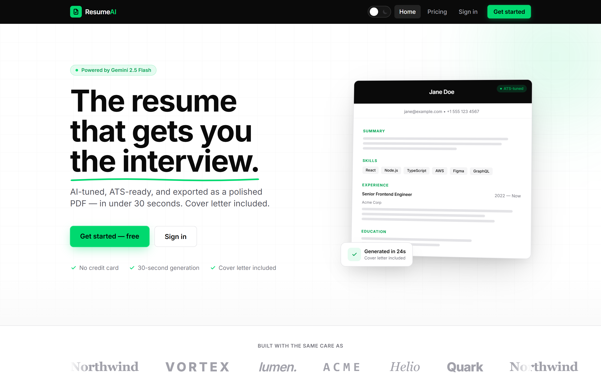
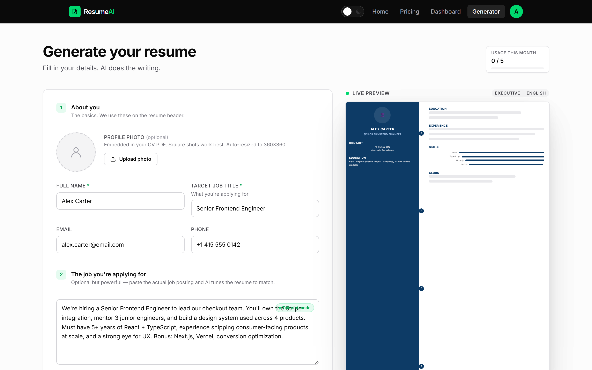
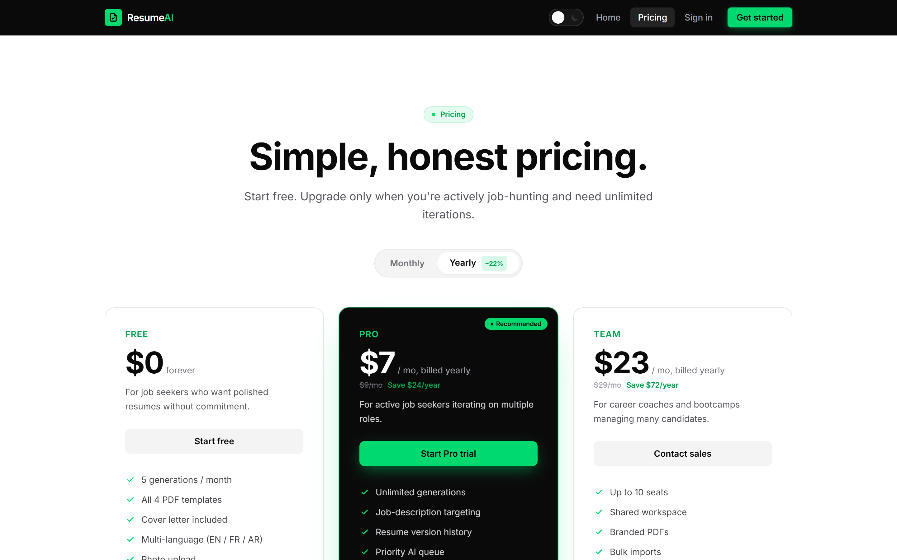
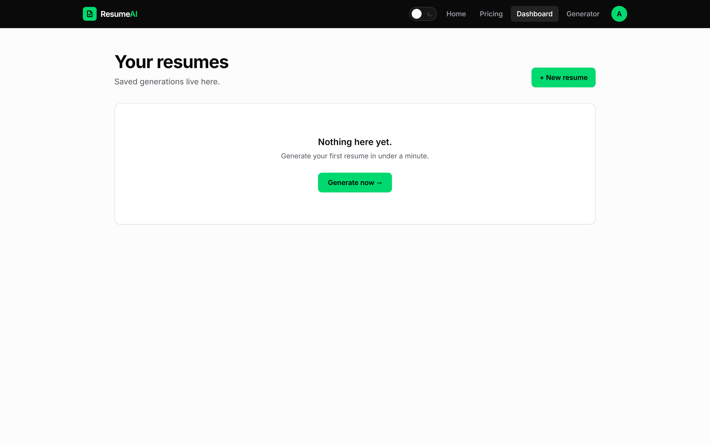
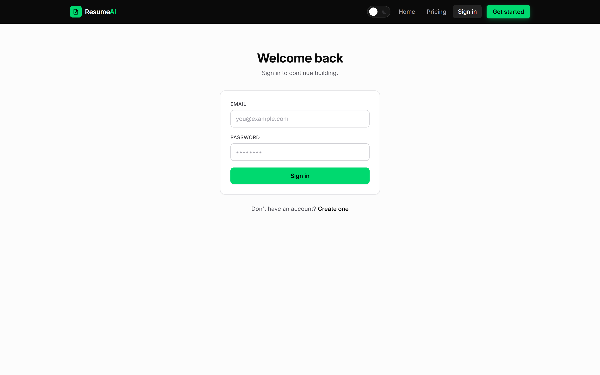
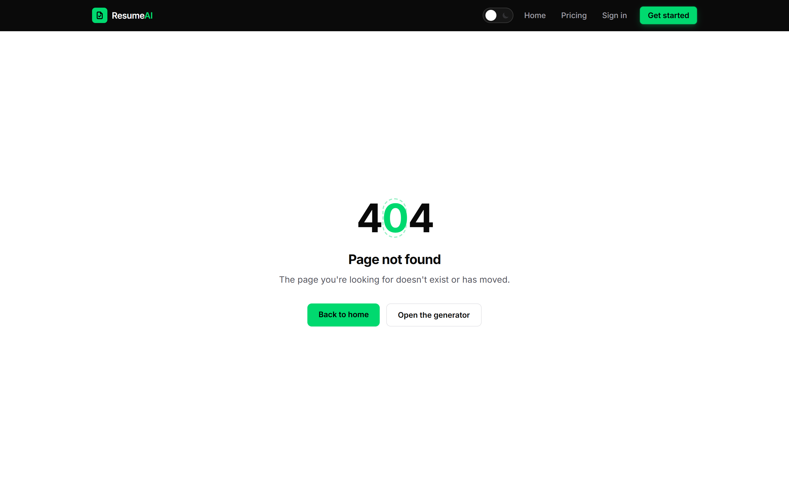

# ResumeAI — AI Resume & Cover Letter Generator

A full-stack web app that generates **ATS-optimized resumes and tailored cover letters** in seconds. Premium SaaS UI, multi-language output (EN / FR / AR with RTL), 4 polished PDF templates, photo embedding, live form preview, and Stripe-style design.

> Two parallel versions in this repo:
> - **`/client` + `/backend`** — production app (React 18 + Vite + Express + MongoDB + Gemini). Fully featured.
> - **`/web`** — modern rebuild in Next.js 15 + TypeScript + Supabase (Phase 1: auth + landing + dashboard skeleton).

---

## 📸 Screenshots

### Landing


### Generator with live template preview


### Pricing


### Dashboard


### Auth (Sign in)


### 404


> Mobile + full-page captures live in [`client/public/screenshots/`](client/public/screenshots/).

---

## ✨ Highlights

- **AI generation** — Google Gemini 2.5 Flash, single prompt → resume + cover letter
- **Job-description targeting** — paste the actual job posting and AI mirrors the employer's language
- **Multi-language** — English / French / Arabic (with auto RTL preview detection)
- **4 PDF templates** — Executive (premium navy + timeline + skill bars), Modern (green band), Classic (centered serif navy), Creative (two-column dark sidebar)
- **Photo upload** — auto-resized to 360×360, circular-cropped, embedded in PDF templates
- **Live form preview** — scaled mock of your chosen template updates in real time as you type
- **Form autosave** to localStorage; **regenerate** without retyping; **duplicate** saved resumes
- **Usage limits** — 5 free generations / month enforced server-side; Pro = unlimited
- **Authentication** — JWT + bcrypt, protected routes, password change endpoint
- **Dashboard** — search + filters, language + template badges, copy-to-clipboard
- **Polished UI** — dark mode, mobile responsive, scroll progress bar, page transitions, reveal animations on scroll, toast notifications, profile dropdown, focus-visible accessibility
- **Production ready** — code-split routes (initial bundle ~263 KB), Vercel + Railway configs, ErrorBoundary, SEO meta tags + OG image, sitemap, robots.txt

---

## 🧱 Stack

**v1 (`client/` + `backend/`)**
- React 18 · Vite 5 · TailwindCSS 3 · React Router 7
- Express 4 · MongoDB (Mongoose) · JWT · bcrypt
- Google Gemini 2.5 Flash · jsPDF + jspdf-autotable

**v2 (`web/`)**
- Next.js 15 (App Router · React Server Components · Server Actions)
- TypeScript 5 (strict)
- Supabase (Auth + Postgres + RLS)
- TailwindCSS 3 · `@supabase/ssr` for cookie-based session management

---

## 🚀 Quick start (v1)

```bash
git clone <this-repo>
cd ai-resume-generator
npm install               # root concurrently script
npm run dev               # backend on :5000, client on :5173
```

Open [http://localhost:5173](http://localhost:5173).

### Prerequisites
- Node.js 18+
- MongoDB (local `mongod` or [MongoDB Atlas](https://www.mongodb.com/atlas))
- Google Gemini API key — [aistudio.google.com/apikey](https://aistudio.google.com/apikey) (free tier: 1 500 req/day)

### Env vars

```bash
# backend/.env
GEMINI_API_KEY=AIza...
MONGODB_URI=mongodb://127.0.0.1:27017/resumeDB
JWT_SECRET=any_long_random_secret
PORT=5000
GEMINI_MODEL=gemini-2.5-flash
CLIENT_ORIGIN=http://localhost:5173
```

```bash
# client/.env (optional — defaults to localhost:5000/api)
VITE_API_URL=http://localhost:5000/api
```

Copy from `.env.example` files in each folder.

---

## 🏗️ Quick start (v2 — Next.js rebuild)

```bash
cd web
npm install
cp .env.example .env.local
# Fill in Supabase + Gemini keys
npm run dev               # http://localhost:3000
```

### Supabase setup
1. Create a project at [supabase.com](https://supabase.com) (free tier)
2. Settings → API → copy the URL + anon key + service_role
3. SQL Editor → paste `web/supabase/migrations/001_initial.sql` → Run
4. Drop the values into `web/.env.local`

---

## 🌍 Deployment

### Frontend → Vercel
```bash
cd client      # or `cd web` for the Next.js version
vercel --prod
```
Set `VITE_API_URL` (or `NEXT_PUBLIC_SUPABASE_URL`/`NEXT_PUBLIC_SUPABASE_ANON_KEY`) in Vercel project settings.

### Backend (v1 only) → Railway
- Create project from this repo → pick `backend/` directory
- Add env: `MONGODB_URI`, `JWT_SECRET`, `GEMINI_API_KEY`
- `railway.json` and `Procfile` are committed for one-click deploy

### MongoDB → [Atlas free tier](https://www.mongodb.com/atlas)
512 MB handles thousands of resumes.

---

## 📡 API reference (v1)

All `/api/resume/*` and `/api/auth/me` routes require `Authorization: Bearer <token>`.

| Method | Path | Description |
|---|---|---|
| POST | `/api/auth/register` | Create account; returns JWT + user |
| POST | `/api/auth/login` | Login; returns JWT + user |
| GET | `/api/auth/me` | Current user (with usage) |
| POST | `/api/auth/change-password` | Change password |
| POST | `/api/auth/toggle-plan` | Toggle free ↔ premium (testing helper) |
| POST | `/api/resume` | Generate + save resume and cover letter |
| POST | `/api/resume/:id/duplicate` | Clone a saved resume |
| GET | `/api/resume/me` | List saved resumes (compact) |
| GET | `/api/resume/:id` | Get a saved resume (full) |
| DELETE | `/api/resume/:id` | Delete a saved resume |

Returns `402 quota_exceeded` when free-tier user hits the monthly limit.

---

## 🎨 Design system

- **Accent color** — `#00d96f` (electric green) — used for CTAs, focus rings, brand mark
- **Body font** — Inter (Google Fonts), with `cv02 cv03 cv04 cv11` features for sharper numerals
- **Dark mode** — `class` strategy with no-flash bootstrap script in `<head>`
- **Animations** — `prefers-reduced-motion` respected on every keyframe
- **Accessibility** — focus-visible green ring on all interactive elements

---

## 📜 License

MIT
